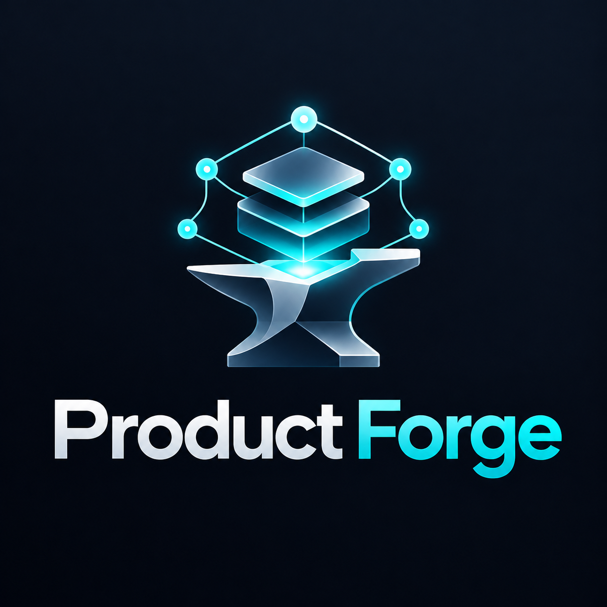

# Product Forge

<p align="center">
  
</p>

**Product Intelligence, Analytics Intelligence & Agentic Workspace** — a specialist Forge in the Forge ecosystem for Product Managers, Product Analysts and technical teams.

## What it is

Product Forge turns scattered product knowledge (docs, metrics, APIs, data sources, decisions) into a governed, queryable, agent-ready context:

- **Product Context Packages** — curated per-product context: entities, sources, agents, data contracts.
- **Knowledge & Graph** — ingestion → chunking → FTS retrieval with citations → entity/relation graph.
- **Agent Factory** — define, evaluate, publish product-specialist agents with scoped permissions.
- **Analytics Studio** — read-only-by-default governed SQL over registered data sources (NL, visual builder, advanced editor sharing one contract).
- **Dashboard Studio** — real-data KPI cards, charts, filters, sharing.
- **Planning & Discovery** — opportunities, hypotheses, prioritization, PRDs, roadmaps, decisions with evidence traceability.
- **Product Operations** — scheduled reports, watches, alerts, approvals.

Surfaces: **CLI** (`productforge`), **HTTP API** (`/api/v1`, `forge/PortalApi/1` envelope), **MCP server** (`productforge mcp serve`), **Forge Portal** (`productforge portal`).

## Install

Bootstrap the CLI (wheel → isolated venv → launcher):

```bash
./install.sh          # POSIX · ./install.windows.sh · ./install.ps1
# or dev flow: uv venv .venv && uv pip install -p .venv/bin/python -e ".[dev]"
```

Then install the Forge — bare `productforge install` on a TTY opens the
**guided wizard** (same contract as `sparkforge-aws install`):

1. **Scope** — `project` | `workspace` | `user`
2. **Install profile** — `minimal` | `recommended` | `full`
3. **Execution profile** — `economy` | `balanced` | `deep`
4. **Components** — `skills`, `agents`, `mcp`, `tui`, `graph-studio`
5. **Hosts** — `claude`, `devin`, `codex`, `copilot` | `all` | `none`
6. Real dry-run plan → confirm → apply → doctor

Flags keep CI non-interactive JSON:

```bash
productforge install --yes --scope project --host claude,devin \
  --components skills,agents,mcp --gateway-profile balanced
productforge install --dry-run                    # plan only, zero writes
productforge repair / update / uninstall          # lifecycle verbs (ledger-governed)
productforge status
```

Install is governed by the **vendored forge installkit** (`src/product_forge/_installkit.py`, canonical `the-forge/scripts/installkit`) — the same engine spark-forge-aws uses: profile-gated assets, ledger-tracked ownership (uninstall removes only owned files), AGENTS.md marker blocks, `.mcp.json` registration, drift detection and repair. The 16 `pf-*` skills ship inside the wheel (`force-include`) into each selected host's skills dir; content bundles (`rules`, `evals`, `knowledge`) land under `<state_dir>/bundle/`.

Full guide: [docs/INSTALL.md](docs/INSTALL.md).

## Quickstart

```bash
productforge workspace create "My Company"
productforge product create <workspace_id> "Payments" --domain fintech
productforge knowledge import <product_id> docs/payments.md
productforge knowledge query <product_id> "retry policy"
productforge agent create <product_id> "Payments Analyst" --template product-analyst
productforge api serve            # local API on 127.0.0.1
productforge portal               # visual studio
productforge mcp serve            # MCP tools for agent hosts
```

## Ecosystem compatibility

- `forge/SpecialistAgenticManifest/v1` → `forge.agentic.json` (Forge Protocol provider).
- `forge/PortalApi/1` envelope on every API response (`schema` + `correlation_id` + `data|error`).
- Vendored `_forge_portal.py` (byte-parity with `forge-portal/portal_core/forge_portal.py`) + `ProductForgePortal` adapter.
- Read-only by default; mutations need the local bearer token (`productforge api token --show`).

## Skills

`skills/` ships 16 domain skills (§15.3: strategy, discovery, prioritization, requirements, SQL, analytics, dashboards, AWS, Azure, APIs, data products, governance, FinOps, reporting, knowledge, agent factory) — each validated with `skill-creator` (`agents/openai.yaml` + `quick_validate` clean). Index: `skills/index.json`.

## MCP

`productforge mcp serve` — stdio JSON-RPC server exposing 14 tools: `productforge_status`, `product_list`, `product_context`, `knowledge_query`, `agent_list`, `product_graph`, `knowledge_health`, `query_validate`, `dashboard_list`, `roadmap`, `alerts_list`, `audit_list`, `agent_run`, `agent_eval`. `install --scope project` registers it in `.mcp.json` for host auto-discovery.

## Status

Beta — Cycles 1–18 complete: foundation → knowledge/graph → agent runtime → analytics → dashboards → planning → cloud/API/data-product intelligence → operations → advanced agentic → homologation → Portal studio → real LLM runtime → semantic metrics → health/evidence/experiments → persona homologation. The Payments Product Intelligence scenario runs end-to-end (`tests/test_homologation.py`) plus a negative-scenario suite. See `docs/audit/` for the ecosystem audit, ADRs and the readiness report; deferred items are listed there explicitly.

## Docs

| Doc | Covers |
|---|---|
| [docs/INSTALL.md](docs/INSTALL.md) | bootstrap scripts, guided wizard, scopes/profiles/components/hosts, bundles, lifecycle verbs |
| [docs/API.md](docs/API.md) | `forge/PortalApi/1` envelope, auth, full `/api/v1` route index |
| [docs/MCP.md](docs/MCP.md) | 14 MCP tools + transport + registration |
| [docs/adr/](docs/adr/) | architecture decisions |
| [docs/audit/](docs/audit/) | ecosystem audit, integration contracts, readiness report |
| [CHANGELOG.md](CHANGELOG.md) | cycle history + hard invariants |
| [AGENTS.md](AGENTS.md) | hard rules + commands for agents working in this repo |
